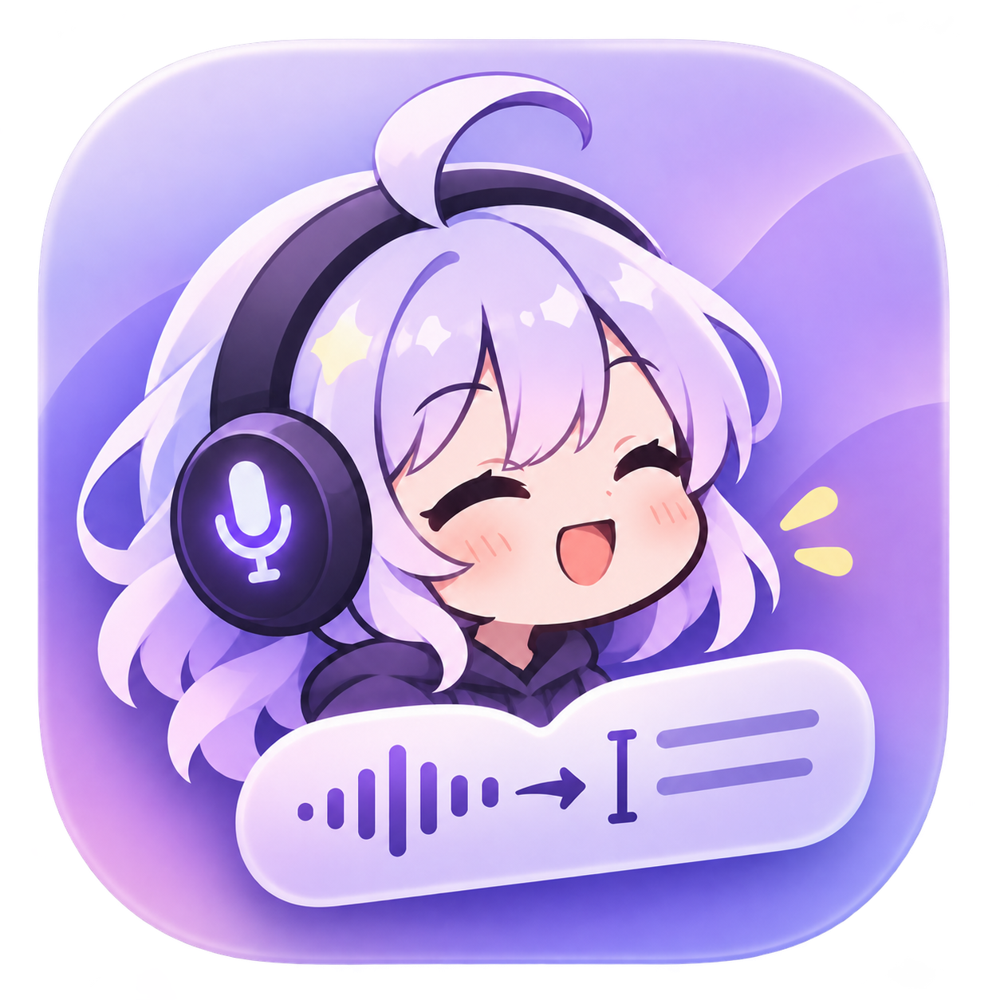

<p align="center"></p>

# local-wispr

A native macOS dictation app for your own speech and language models. Hold a shortcut, speak, and release to paste the transcript into the app you were using. An optional **Polish** pass fixes the text before insertion.

local-wispr runs in the menu bar and shows a small waveform while recording. Dictation can run on this Mac with a downloaded Whisper model, or on a server you configure. Polish is an optional server pass. **There is no hosted service. Model weights are downloaded separately when you choose Download.**

## What it does

- Push to talk, or double-tap a shortcut for hands-free recording.
- An English starter profile; add any language your server supports, with its own model, shortcuts, and wave color.
- Raw, Light, and Polished text styles, with editable prompts and a pronunciation/spelling dictionary.
- Searchable local transcript history, original-text comparison, re-Polish with five previous versions, and retry after a failed transcription.
- Optional paste-last shortcut, exact dictionary corrections in every mode, silence skipping, and one automatic microphone recovery attempt.
- Light, dark, and system appearance; adjustable waveform size and screen position.
- Microphone selection, input-level testing, permission checks, and shortcut tests.

## Requirements

- macOS 14 or later and a microphone.
- Xcode 26 or later selected as the active developer directory, plus Python 3 for build scripts.
- For on-device Dictation: an Apple silicon Mac and internet for the initial model download.
- For server mode: a speech server on port **8090** and, for optional Polish, a chat server on port **8080**. Both must implement the [backend contract](docs/backend.md). The app currently uses HTTP without API-key authentication, so use a trusted local network or an encrypted VPN.

On-device recognition uses WhisperKit through Core ML. Swift package versions are pinned in the package lockfiles. In server mode, model IDs must match models already served by your backend; entering a name does not install it.

## Build and install

From the repository directory, configure signing once. You can select an existing signing identity:

```sh
python3 scripts/signing.py use 'Apple Development: Your Name (TEAMID)'
```

Alternatively, create a certificate for builds on your own Mac:

```sh
python3 scripts/signing.py create-local
```

The second command adds a certificate and private key to your login Keychain, with user-level trust restricted to code signing. Reuse that identity across builds so macOS can recognize permission grants. See [signing details](CONTRIBUTING.md#signing).

Build, then copy the app to Applications using Finder:

```sh
./scripts/build.sh
open build/Build/Products/Release
```

Quit any existing copy before replacing it. Launch `/Applications/local-wispr.app` and keep using that installed copy. This builds a locally signed app, not a notarized public download.

## Dictate without a server

1. Open **LLM**, then select **On this Mac**.
2. Download **Whisper Base**, about 150 MB, for a compact starting point, or **Whisper Small**, about 490 MB, for better accuracy. Both support multiple languages. Download sizes exclude Core ML's device-specific cache.
3. Leave **Use server for Polish** off. Dictation and exact dictionary corrections then run locally, without a model endpoint.
4. Open **Setup & test**, grant permissions, and try your shortcut. Add languages in LLM and set their shortcuts in Settings.

The first transcription can take longer while Core ML prepares the model. The selected model prepares in the background and stays in memory for five idle minutes, so repeated dictations avoid model loading. Cancel or retry downloads, or remove a model in LLM. Verified complete files are reused after a cancelled download; an incomplete file is downloaded again. A failed local transcription never sends audio to a server as a fallback.

If you enable **Use server for Polish**, Light and Polished modes send the transcript to your configured chat server. Raw mode stays local. Your existing server model selections remain saved when switching modes. Server remains the initial selection for compatibility; choose On this Mac to use the downloadable models.

## Connect model servers

Follow the [local model setup guide](docs/local-model-setup.md) to configure Dictation and Polish endpoints, check model IDs with curl, and connect services on your Mac or another machine. It includes Speaches and LM Studio examples, Raw mode without a chat model, and troubleshooting.

## First dictation

1. Choose **Open app** from the menu bar, then **LLM**. Set the server hostname or IP, without a URL scheme or port. New installations start with `127.0.0.1`.
2. Check the connection and select a Dictation model for each language and a shared Polish model. Use Raw in Settings if you only have a speech server.
3. Open **Setup & test**. Grant Microphone, Input Monitoring, and Accessibility access. Restart the app if macOS requests it, then test your shortcuts.
4. Click the test text box, hold your shortcut, speak, and release. The waveform appears during recording; the transcript arrives after processing.

Default shortcuts use these physical keys:

| Language | Push to talk | Hands-free |
| --- | --- | --- |
| English | Hold F1 | Double-tap F1 to start; press F1 once to finish |

To add another language, open **LLM → Add language**, choose a language or enter its code, and select a compatible model from your server or enter its ID. Then assign its shortcuts in Settings. You can remove English after adding another profile. Existing language profiles and custom settings are preserved when upgrading.

Hands-free follows the push-to-talk shortcut by default. Edit either shortcut in Settings, with up to two keys per combination. Escape cancels active recording or processing; recordings stop at two minutes. Failed transcriptions keep their audio until you choose Retry or Discard in the menu bar. If F1 changes brightness, enable standard function keys in macOS Keyboard settings.

The app attempts to paste into the original text field and never presses Return. If focus changed or automatic insertion is unavailable, use **Copy text** and paste manually.

## Dictionary, history, and recording recovery

- **Dictionary:** “Often heard as” phrases are replaced locally before Polish, including in Raw mode. Matching ignores case, prefers the longest phrase, and supports languages without spaces. Replacements do not cascade. Entries without an “Often heard as” phrase provide vocabulary guidance to Polish only.
- **Paste last:** choose a shortcut in Settings → Paste last dictation, or use the menu-bar action. No shortcut is assigned automatically. It pastes into the currently focused field, with the same focus and clipboard safeguards as dictation.
- **Re-Polish:** open a dictation's ⋯ menu and choose Light or Polished. This sends the original transcript through your current dictionary and Polish settings, saves the result, and never pastes automatically. Expand the details to restore a previous version. Up to five are retained; failures keep the existing text.
- **Silence:** Settings → Recording → Skip silent recordings is on by default. This conservative volume gate skips silence and extremely quiet audio; it does not classify speech or filter room noise. Turn it off for whispers or quiet microphones.
- **Microphone recovery:** if audio stops arriving for four seconds, the app tries reopening the same device once. It never switches devices during a recording. A successful recovery keeps captured audio but may leave a gap, so the result is copied for review instead of auto-pasted. If recovery fails, use Transcribe captured audio or Discard in the menu bar. Reconnect the microphone before the next recording.

## Data and privacy

In server mode, audio goes to your speech server. In On this Mac mode, audio stays on the Mac. When server Polish is enabled, Light and Polished modes send the transcript and relevant dictionary entries to your chat server. Raw skips that second request. There is no bundled analytics SDK or account requirement.

History and dictionary entries are stored as plaintext on your Mac. History retention defaults to 30 days. Failed transcriptions retain temporary audio for retry; a forced exit can leave temporary recordings behind. Review [storage, transport, and reporting details](SECURITY.md) before dictating sensitive information.

## Troubleshooting

- **No waveform:** check Setup & test for missing permissions, then Settings → Recording for an available microphone. Test the microphone and shortcut separately.
- **Permission granted but still unavailable:** restart the installed app. If several copies exist, use the setup page's Finder action to identify the running copy before correcting its permission entry.
- **Server or model errors:** check LLM and verify your server implements the required endpoints and accepts M4A audio. A failed Polish request keeps the transcript with local dictionary corrections.
- **Text not inserted:** keep the original app and field focused while processing, or copy from Dictation.

## Development and license

Run `swift test` for local checks. See [CONTRIBUTING.md](CONTRIBUTING.md) for builds, optional live tests, and manual verification, and the [release audit](docs/release-audit.md) for publication follow-ups.

Code is licensed under [MIT](LICENSE). See [third-party notices](THIRD_PARTY_NOTICES.md) for acknowledgments to Diction, OpenSuperWhisper, Anatomy, and Hex.
